

  
  
  
  




<a href="https://github.com/j2445"></a>

  
  

<a href="https://github.com/j2445"></a>

  
  

<a href="https://github.com/j2445"></a>

  



  

<a href="https://joy-1.vercel.app/#certifications"></a>

  
  
  
  

